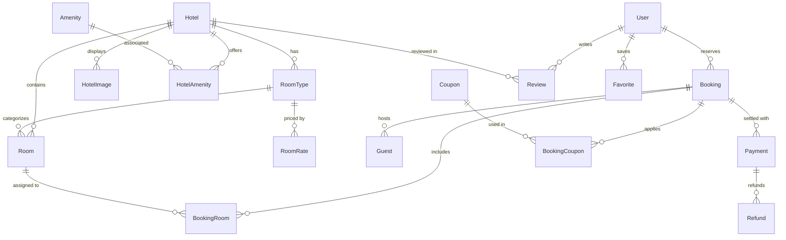

# StayEase Database Schema & Architecture

StayEase uses **PostgreSQL** paired with **Prisma ORM** for strong type-safety, relational integrity, foreign key constraints, indexes, and transactional concurrency protection.

---

## 1. Schema Overview

The database contains **20 core models** organized into domain modules:
1. **Identity & Access**: `User`, `Notification`, `AuditLog`
2. **Hotels & Amenities**: `Hotel`, `HotelImage`, `Amenity`, `HotelAmenity`
3. **Room Inventory & Rates**: `RoomType`, `Room`, `RoomRate`, `Maintenance`
4. **Reservations & Guests**: `Booking`, `BookingRoom`, `Guest`
5. **Billing & Payments**: `Payment`, `Refund`, `Coupon`, `BookingCoupon`
6. **Social & Engagement**: `Review`, `Favorite`



---

## 2. Core Models

### User
- `id`: UUID (Primary Key)
- `email`: String (Unique, Indexed)
- `passwordHash`: String (bcrypt-hashed)
- `firstName`, `lastName`, `phone`: Strings
- `role`: Enum `Role` (`CUSTOMER`, `RECEPTIONIST`, `HOTEL_MANAGER`, `SUPER_ADMIN`)
- `assignedHotelId`: UUID (Nullable foreign key scoping staff to their assigned hotel)
- `isActive`: Boolean (Default `true`)
- `resetPasswordToken`, `resetPasswordExpires`: Nullable string/timestamp for secure single-use recovery.

### Hotel
- `id`: UUID (Primary Key)
- `name`: String
- `slug`: String (Unique, Indexed)
- `description`: Text
- `starRating`: Integer (1-5)
- `address`, `city`, `state`, `country`, `postalCode`: Strings
- `latitude`, `longitude`: Floats
- `phone`, `email`: Strings
- `checkInTime`, `checkOutTime`: Strings (e.g., "15:00", "11:00")
- `cancellationPolicy`: Text
- `isPublished`: Boolean (Default `true`, Indexed)

### RoomType & Room
- **`RoomType`**:
  - `id`: UUID
  - `hotelId`: UUID -> Hotel
  - `name`: String (e.g. "Oceanfront Deluxe King")
  - `description`: Text
  - `maxOccupancy`, `maxAdults`, `maxChildren`: Integers
  - `basePricePerNight`: Decimal(10, 2)
  - `sizeSqM`: Float
  - `bedType`: String
- **`Room`**:
  - `id`: UUID
  - `hotelId`: UUID -> Hotel
  - `roomTypeId`: UUID -> RoomType
  - `roomNumber`: String (Unique per hotel: `@@unique([hotelId, roomNumber])`)
  - `floor`: Integer
  - `status`: Enum `RoomStatus` (`AVAILABLE`, `OCCUPIED`, `MAINTENANCE`, `DIRTY`, `CLEANING`)
  - `isActive`: Boolean

### Booking & BookingRoom
- **`Booking`**:
  - `id`: UUID
  - `bookingReference`: String (Unique, Indexed, e.g. `SE-202611-ABC123`)
  - `userId`: UUID -> User
  - `hotelId`: UUID -> Hotel
  - `status`: Enum `BookingStatus` (`PENDING`, `CONFIRMED`, `CHECKED_IN`, `CHECKED_OUT`, `CANCELLED`, `NO_SHOW`)
  - `paymentStatus`: Enum `PaymentStatus` (`UNPAID`, `AUTHORIZED`, `PAID`, `REFUNDED`, `PARTIALLY_REFUNDED`, `FAILED`)
  - `checkInDate`: DateTime (Stored at 00:00:00 UTC)
  - `checkOutDate`: DateTime (Stored at 00:00:00 UTC)
  - `holdExpiresAt`: Nullable DateTime (15-minute temporary hold)
  - `subtotal`, `taxAmount`, `discountAmount`, `serviceFee`, `totalAmount`: Decimal(10, 2) (Immutable snapshot)
  - `currency`: String (Default "USD")
  - `cancellationReason`: Nullable Text
  - `cancelledAt`: Nullable DateTime
- **`BookingRoom`**:
  - `id`: UUID
  - `bookingId`: UUID -> Booking (Cascade delete)
  - `roomTypeId`: UUID -> RoomType
  - `roomId`: Nullable UUID -> Physical Room (Assigned upon hold or check-in)
  - `pricePerNight`: Decimal(10, 2)
  - `nights`: Integer

### Payment & Refund
- **`Payment`**:
  - `id`: UUID
  - `bookingId`: UUID -> Booking
  - `transactionId`: String (Unique, Indexed)
  - `provider`: String ("RAZORPAY" or "SIMULATED")
  - `orderId`: String (Unique, Indexed)
  - `amount`: Decimal(10, 2)
  - `currency`: String
  - `status`: Enum `PaymentStatus`
  - `method`: String ("CARD", "UPI", "NETBANKING", "WALLET")
- **`Refund`**:
  - `id`: UUID
  - `paymentId`: UUID -> Payment
  - `refundTransactionId`: String (Unique)
  - `amount`: Decimal(10, 2)
  - `reason`: Text
  - `status`: String ("PROCESSED")

---

## 3. Concurrency & Availability Strategy

### Half-Open Date Intervals `[checkIn, checkOut)`
Hotel reservations operate on nights. A guest checking out on November 5 leaves by 11:00 AM, allowing a new guest checking in on November 5 at 3:00 PM to occupy the room. Availability calculations strictly enforce the half-open query:
```sql
WHERE existing.check_in < requested.check_out
  AND existing.check_out > requested.check_in
```

### Double-Booking Prevention
1. **Interactive Prisma Transactions**: Booking creation occurs within `prisma.$transaction(async (tx) => { ... })`.
2. **Blocking Status Exclusion**: Bookings in statuses `CONFIRMED`, `CHECKED_IN`, and unexpired `PENDING` holds decrement room type inventory count.
3. **Maintenance Exclusion**: Rooms with active maintenance schedules covering the requested stay are excluded.
4. **Atomic Holds**: An initial hold expires in 15 minutes (`holdExpiresAt`). An asynchronous cleanup job cleans expired unfulfilled holds every 2 minutes.

---

## 4. Key Enums

- **`Role`**: `CUSTOMER`, `RECEPTIONIST`, `HOTEL_MANAGER`, `SUPER_ADMIN`
- **`BookingStatus`**: `PENDING`, `CONFIRMED`, `CHECKED_IN`, `CHECKED_OUT`, `CANCELLED`, `NO_SHOW`
- **`PaymentStatus`**: `UNPAID`, `AUTHORIZED`, `PAID`, `REFUNDED`, `PARTIALLY_REFUNDED`, `FAILED`
- **`RoomStatus`**: `AVAILABLE`, `OCCUPIED`, `MAINTENANCE`, `DIRTY`, `CLEANING`
- **`DiscountType`**: `PERCENTAGE`, `FIXED_AMOUNT`

---

## 5. Seeded Data

| User Account | Email | Password | Role | Assigned Hotel |
|---|---|---|---|---|
| Super Admin | `admin@stayease.com` | `Admin@123` | `SUPER_ADMIN` | All Hotels |
| Hotel Manager | `manager@stayease.com` | `Manager@123` | `HOTEL_MANAGER` | Grand Azure Haven |
| Receptionist | `receptionist@stayease.com` | `Staff@123` | `RECEPTIONIST` | Grand Azure Haven |
| Customer | `customer@stayease.com` | `Customer@123` | `CUSTOMER` | None |

Seeded Hotels:
1. **Grand Azure Haven** (Miami, FL) — 5-star oceanfront resort.
2. **Alpine Serenity Lodge** (Aspen, CO) — 5-star mountain retreat.
3. **Lumina Kyoto Garden Hotel** (Kyoto, Japan) — 4-star boutique zen garden hotel.
